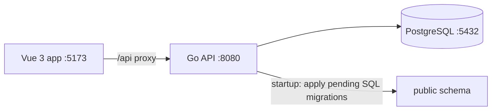

# ReconX

ReconX is a starter for a **Bank Transaction Reconciliation & Exception Management System**. It uses a modular monolith: one Go API and one PostgreSQL database, with business capabilities kept in separate Go modules.

## Technology

- Backend: Go, `net/http`, PostgreSQL through `pgx`
- Frontend: Vue 3, TypeScript, Vite
- Local database: PostgreSQL through Docker Compose or an existing local PostgreSQL installation

## Request and startup flow



1. The API loads configuration from the project `.env` file (or process environment variables).
2. It opens a PostgreSQL connection and checks that the database is reachable.
3. It applies unapplied, versioned SQL migrations from `backend/migrations` and records them in `schema_migrations`.
4. It starts the HTTP server and logs requests. `Ctrl+C` triggers graceful shutdown.
5. Vite serves the Vue app and proxies `/api/*` requests to the Go API.
6. The current dashboard calls `GET /api/v1/health` and displays the API connection state.

## Repository layout

```text
backend/
  cmd/api/                         API entry point
  internal/platform/config/        Environment configuration
  internal/platform/database/      PostgreSQL connection and migration runner
  internal/platform/httpserver/    HTTP routes and request logging
  internal/modules/                identity, banking, reconciliation, exceptions
  migrations/                      Embedded, versioned SQL migrations
frontend/
  src/App.vue                      Initial dashboard
  src/style.css                    Dashboard styles
  vite.config.ts                   Development server and API proxy
docker-compose.yml                 Local PostgreSQL service
.env.example                       Safe local configuration template
```

The modules are intended to own their domain logic and persistence. Cross-module work should go through module services rather than reading another module's tables directly.

## Run locally

Requirements: Go 1.23 or newer, Node.js 22 or newer, npm, and either Docker Compose or PostgreSQL.

### Option A: Docker PostgreSQL

From the project root in PowerShell:

```powershell
Copy-Item .env.example .env
docker compose up -d postgres
```

### Option B: Laragon PostgreSQL

The workspace `.env` can target a local Laragon instance. For a fresh clone, copy the example and set `DATABASE_URL` to the values for your PostgreSQL server. For the Laragon setup used during development:

```powershell
Copy-Item .env.example .env
(Get-Content .env) -replace '^DATABASE_URL=.*$', 'DATABASE_URL=postgres://postgres@127.0.0.1:5432/reconx?sslmode=disable' | Set-Content .env
```

Start PostgreSQL from Laragon. Create the application database once if it does not exist:

```powershell
& 'C:\laragon\bin\PostgreSQL\18\bin\psql.exe' -U postgres -h 127.0.0.1 -p 5432 -d postgres -c 'CREATE DATABASE reconx;'
```

The Laragon example assumes its local PostgreSQL authentication permits the `postgres` user without a password. Adjust `DATABASE_URL` if your local PostgreSQL credentials or port differ. Do not start the Docker PostgreSQL service on port 5432 while Laragon already uses that port.

### Start the API and frontend

Open two PowerShell terminals.

Terminal 1 — backend:

```powershell
cd C:\ReconX\backend
go mod tidy
go run ./cmd/api
```

Terminal 2 — frontend:

```powershell
cd C:\ReconX\frontend
npm install
npm run dev
```

Open <http://localhost:5173>. The API listens on <http://localhost:8080>.

To create a production frontend bundle:

```powershell
npm run build
```

## API endpoints

| Method | Path | Purpose |
| --- | --- | --- |
| `GET` | `/api/v1/health` | Liveness check for the HTTP API |
| `GET` | `/api/v1/ready` | Readiness check that also pings PostgreSQL |

Vite proxies browser requests from `/api` to `API_PROXY_TARGET` (default `http://localhost:8080`).

## Database schema

Pending migrations run automatically when the API starts. The initial schema is created in PostgreSQL's `public` schema:

- `users`
- `bank_accounts`
- `bank_transactions`
- `reconciliation_runs`
- `reconciliation_matches`
- `reconciliation_exceptions`
- `schema_migrations`

These tables are initially empty. The current scaffold does **not** include bank-statement import, reconciliation endpoints, authentication, or exception-management workflows, so it does not insert transaction or user records yet. Those capabilities are the next implementation steps.

In HeidiSQL, connect to the same PostgreSQL host, port, and database from `DATABASE_URL`, then refresh `reconx` and expand `public` → `Tables`. `pg_catalog`, `information_schema`, and `pg_toast` are PostgreSQL-managed schemas.

## Configuration

| Variable | Default | Description |
| --- | --- | --- |
| `APP_ENV` | `development` | Environment label included in API startup logs |
| `API_ADDR` | `:8080` | HTTP listen address |
| `DATABASE_URL` | Local `reconx` PostgreSQL URL | PostgreSQL connection string |
| `API_PROXY_TARGET` | `http://localhost:8080` | Vite development proxy target |

Keep local secrets and credentials in `.env`; only `.env.example` belongs in Git.
