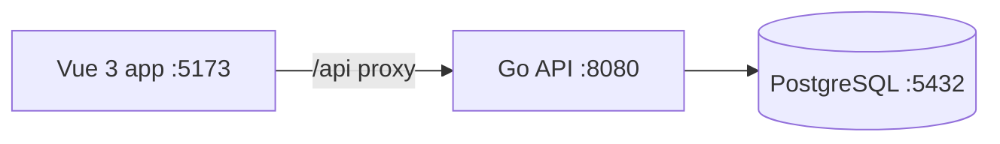

# ReconX

ReconX is a starter for a **Bank Transaction Reconciliation & Exception Management System**. It uses a modular monolith: one Go API and one PostgreSQL database, with business capabilities kept in separate Go modules.

## Technology

- Backend: Go, `net/http`, PostgreSQL through `pgx`
- Frontend: Vue 3, TypeScript, Vite
- Local database: PostgreSQL through Docker Compose or an existing local PostgreSQL installation

## Request and startup flow



1. The API loads configuration from the project `.env` file (or process environment variables).
2. It opens a PostgreSQL connection and checks that the database is reachable.
3. It starts the HTTP server and logs requests. `Ctrl+C` triggers graceful shutdown.
4. Vite serves the Vue app and proxies `/api/*` requests to the Go API.
5. The current dashboard calls `GET /api/v1/health` and displays the API connection state.

## Repository layout

```text
backend/
  cmd/api/                         API entry point
  internal/platform/config/        Environment configuration
  internal/platform/database/      PostgreSQL connection
  internal/platform/httpserver/    HTTP routes and request logging
  internal/modules/                identity, banking, reconciliation, exceptions
    identity/                      MVP RBAC policy and route guard
    banking/                       Synthetic account and transaction contracts
    reconciliation/                Batch, match, run, approval, and close contracts
    exceptions/                    Exception types and references
  examples/                        Synthetic FSD CSV fixtures
frontend/
  src/App.vue                      Initial dashboard
  src/style.css                    Dashboard styles
  vite.config.ts                   Development server and API proxy
docker-compose.yml                 Local PostgreSQL service
.env.example                       Safe local configuration template
```

The modules are intended to own their domain logic and persistence. Cross-module work should go through module services rather than reading another module's tables directly.

## Run locally

Requirements: Go 1.23 or newer, Node.js 22 or newer, npm, and either Docker Compose or PostgreSQL.

### Option A: Docker PostgreSQL

From the project root in PowerShell:

```powershell
Copy-Item .env.example .env
docker compose up -d postgres
```

### Option B: Laragon PostgreSQL

The workspace `.env` can target a local Laragon instance. For a fresh clone, copy the example and set `DATABASE_URL` to the values for your PostgreSQL server. For the Laragon setup used during development:

```powershell
Copy-Item .env.example .env
(Get-Content .env) -replace '^DATABASE_URL=.*$', 'DATABASE_URL=postgres://postgres@127.0.0.1:5432/reconx?sslmode=disable' | Set-Content .env
```

Start PostgreSQL from Laragon. Create the application database once if it does not exist:

```powershell
& 'C:\laragon\bin\PostgreSQL\18\bin\psql.exe' -U postgres -h 127.0.0.1 -p 5432 -d postgres -c 'CREATE DATABASE reconx;'
```

The Laragon example assumes its local PostgreSQL authentication permits the `postgres` user without a password. Adjust `DATABASE_URL` if your local PostgreSQL credentials or port differ. Do not start the Docker PostgreSQL service on port 5432 while Laragon already uses that port.

### Start the API and frontend

Open two PowerShell terminals.

Terminal 1 — backend:

```powershell
cd C:\ReconX\backend
go mod tidy
go run ./cmd/api
```

Terminal 2 — frontend:

```powershell
cd C:\ReconX\frontend
npm install
npm run dev
```

Open <http://localhost:5173>. The API listens on <http://localhost:8080>.

To create a production frontend bundle:

```powershell
npm run build
```

## API endpoints

| Method | Path | Purpose |
| --- | --- | --- |
| `GET` | `/api/v1/health` | Liveness check for the HTTP API |
| `GET` | `/api/v1/ready` | Readiness check that also pings PostgreSQL |
| `GET` | `/api/v1/meta/rbac` | Read-only MVP role and permission definitions from FSD §3.1–3.3 |

Vite proxies browser requests from `/api` to `API_PROXY_TARGET` (default `http://localhost:8080`).

## FSD sections 1–3.3

- The MVP is a synthetic reconciliation demonstration. It must not use real customer or bank data, initiate payments, move funds, post to a ledger, or connect to a real bank.
- The sample end-to-end scenario from FSD §2 is in `backend/examples/internal.csv` and `backend/examples/bank.csv`. The expected outcomes are TRX001 `MATCHED`, TRX002 `AMOUNT_MISMATCH`, TRX003 `INTERNAL_ONLY`, and TRX004 `BANK_ONLY`. The sample batch has three active exceptions and cannot be closed.
- The frontend shows that same sample batch and its four reference outcomes. The approval queue is empty because this sample has unresolved exceptions. UI forms, file selection, reports, and sample data are demonstrations; they do not persist records or run reconciliation.
- Fixed roles and the 19 permission keys from FSD §3.3 are defined in `backend/internal/modules/identity/rbac.go`. The package contains permission checks, own-profile and Operator ownership scoping, Checker-only approval checks, maker/checker separation, and an HTTP permission middleware for future protected routes. Domain contracts in the banking, reconciliation, and exceptions modules represent the §1 concepts; they are not database models or persisted records.
- The current API has no login/session implementation or business endpoints, so no authenticated principal is populated and end-user permissions are not yet enforced on business operations. `GET /api/v1/meta/rbac` only exposes the static role/permission catalog. Do not treat this prototype as production access control.

## Database schema

The application schema is intentionally undefined at this stage. There are no project migrations or application tables in the code, and API startup does not create or modify tables. The API only checks that the configured PostgreSQL database is reachable. We can design the schema and add migrations after the reconciliation requirements are clear.

The Docker Compose service creates an empty database named `reconx`; an existing PostgreSQL database can be used through `DATABASE_URL`. Removing migration files from the repository does not delete tables already present in a local PostgreSQL instance. In HeidiSQL, connect to the configured database and inspect its `public` schema. `pg_catalog`, `information_schema`, and `pg_toast` are PostgreSQL-managed schemas.

## Frontend prototype

The Vue UI follows the ReconX FSD visual direction and includes demo screens for Dashboard, Reconciliation Batches, Batch Detail, Import Data, Transactions, Matching Results, Exceptions, Exception Detail, Approval Queue, Reports, Bank Accounts, User Management, Audit Logs, and Settings. Navigation, filters, detail views, demo forms, file selection preview, notification menu, and sample CSV export are UI-only interactions. The displayed figures are illustrative; uploads, approvals, settings, and records are not persisted or connected to the API yet.

## Configuration

| Variable | Default | Description |
| --- | --- | --- |
| `APP_ENV` | `development` | Environment label included in API startup logs |
| `API_ADDR` | `:8080` | HTTP listen address |
| `DATABASE_URL` | Local `reconx` PostgreSQL URL | PostgreSQL connection string |
| `API_PROXY_TARGET` | `http://localhost:8080` | Vite development proxy target |

Keep local secrets and credentials in `.env`; only `.env.example` belongs in Git.
