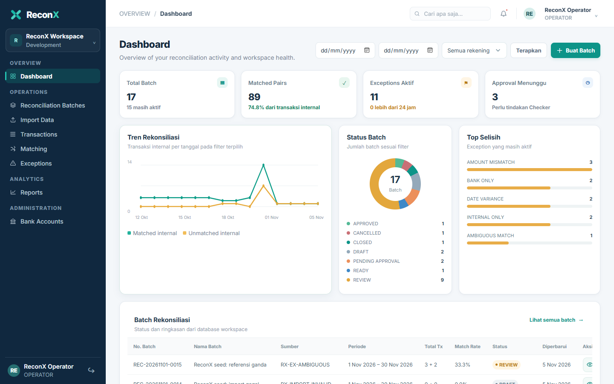
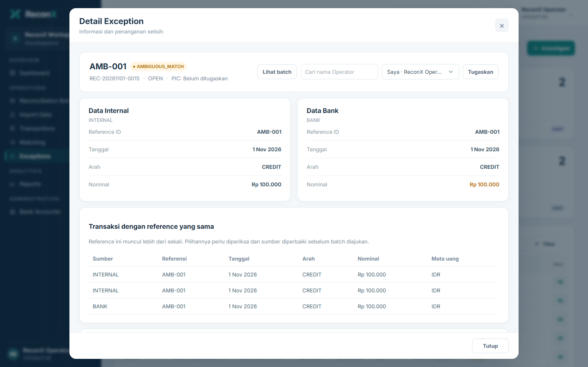
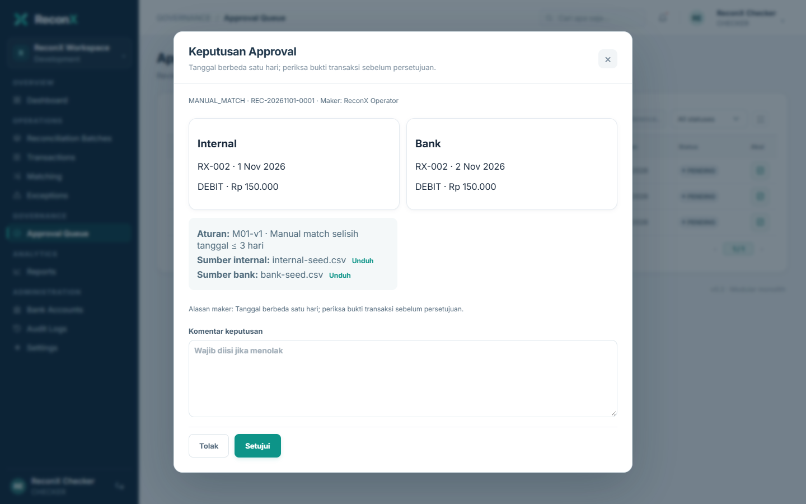

# Panduan demo ReconX

Demo memakai PostgreSQL dan data sintetis dari seeder development. Ikuti langkah konfigurasi dan jalankan migration, seeder, backend, serta frontend seperti dijelaskan pada [README](../README.md). Jika ingin mengulangi alur approval dari awal, gunakan database development baru; seeder tidak mengatur ulang keputusan yang sudah dibuat.

## Akun demo

| Peran | Email | Password awal |
| --- | --- | --- |
| Operator | `operator@reconx.local` | `developer` |
| Checker | `checker@reconx.local` | `developer` |
| Admin | `admin@reconx.local` | `developer` |
| Auditor | `auditor@reconx.local` | `developer` |

Password ini hanya untuk development. Seeder tidak mengubah password akun yang sudah ada.

## Skenario singkat

1. Masuk sebagai Operator dan buka **Exceptions**. Pilih baris `AMBIGUOUS_MATCH` untuk melihat tiga kandidat transaksi dari data seed.
2. Buka exception `DATE_VARIANCE` atau lihat pengajuan yang sudah tersedia pada data seed. Pengajuan manual match hanya berlaku untuk transaksi yang memenuhi syarat toleransi tanggal.
3. Masuk sebagai Checker. Di **Approval Queue**, buka pengajuan `MANUAL_MATCH`, periksa transaksi dan sumber, lalu pilih setujui atau tolak.
4. Untuk batch yang sudah seluruhnya cocok, Operator pemilik batch mengajukan approval. Checker dapat menyetujui dan menutup batch dari detailnya.
5. Buka **Reports** untuk melihat ringkasan atau mengunduh CSV sesuai filter. **Audit Logs** dapat diakses Admin, Checker, dan Auditor.

Untuk mencoba impor baru, gunakan [contoh internal](../frontend/public/contoh/internal-ambiguous.csv) dan [contoh bank](../frontend/public/contoh/bank-ambiguous.csv). Tanggal dalam file harus berada dalam periode batch. File dapat diedit di Excel dan disimpan sebagai CSV UTF-8.

Referensi ganda di satu file diterima oleh implementasi ini dan dapat menghasilkan `AMBIGUOUS_MATCH`. Ini adalah perubahan yang diminta pada proyek setelah FSD v1.0, yang awalnya meminta penolakan referensi ganda. Pencocokan ambigu tidak dilakukan otomatis; sumber perlu diperbaiki dan diimpor ulang untuk melanjutkan.

